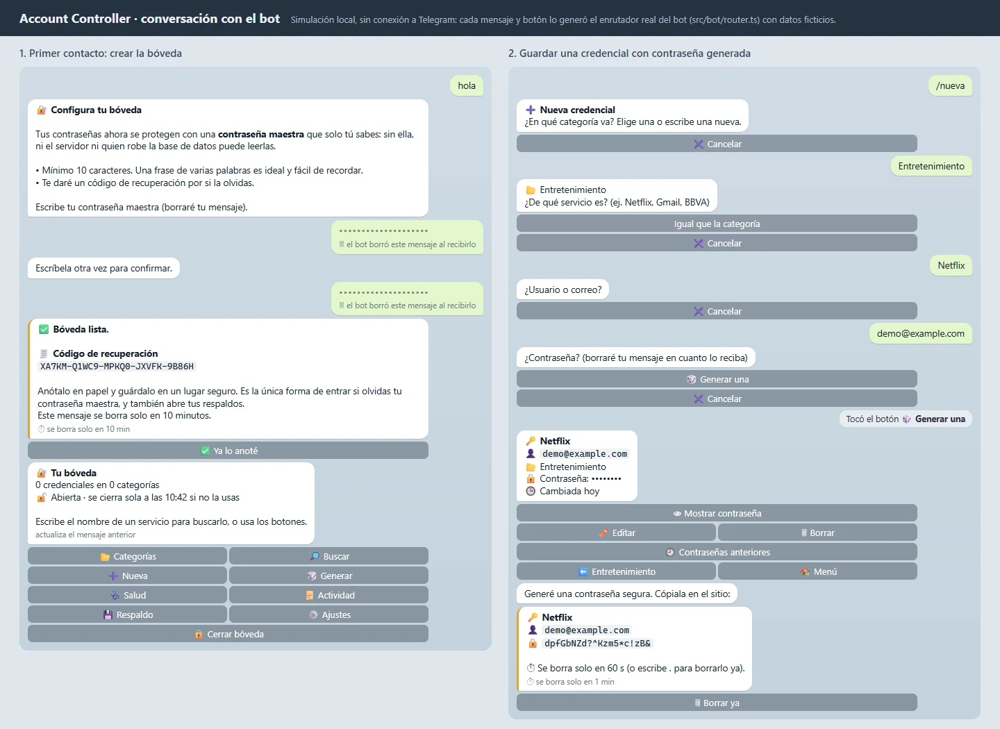
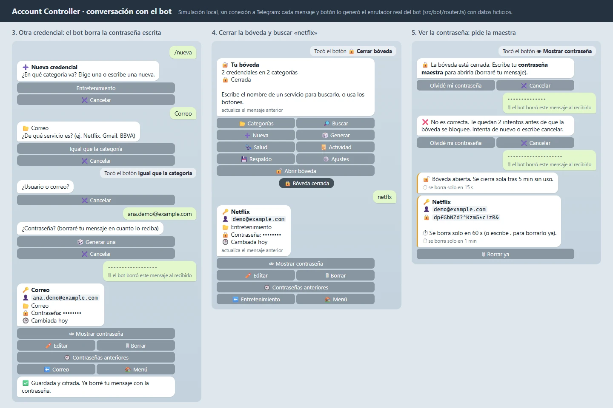
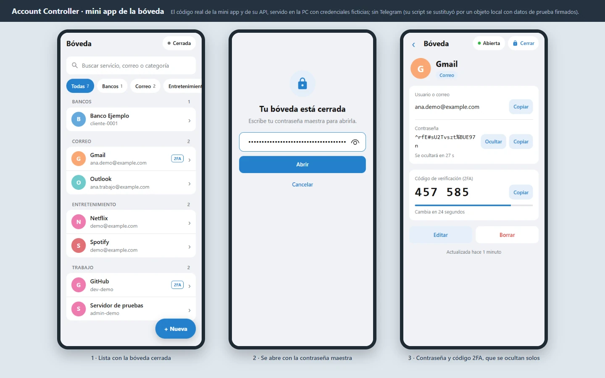
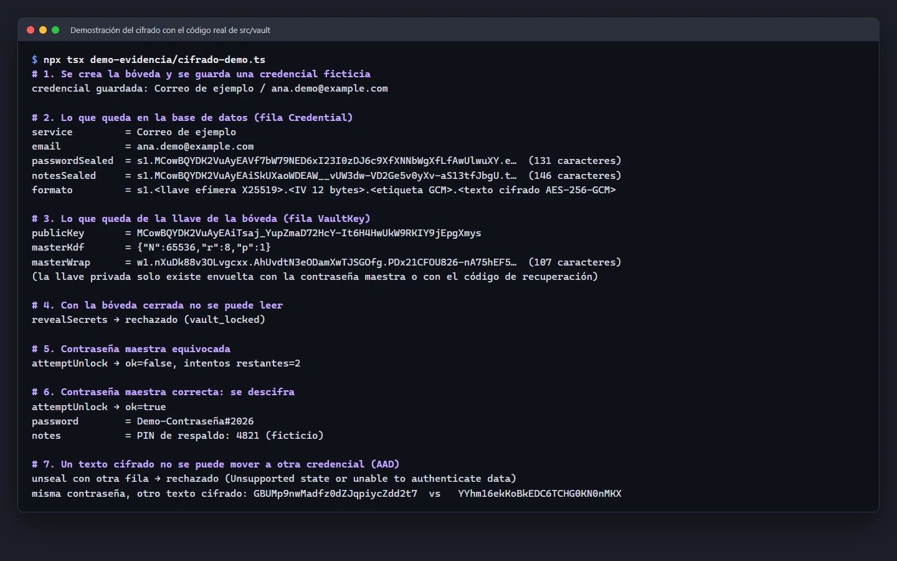
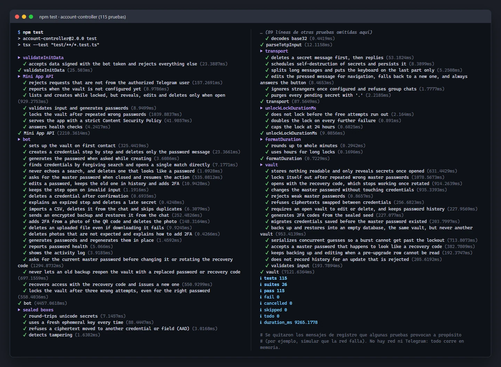
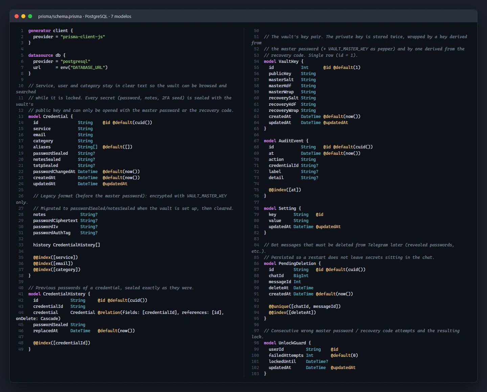

# Evidencia

Capturas reales del programa funcionando, tomadas el 22 de noviembre de 2026 con **datos de demostración**
(nombres, cuentas y cifras inventadas). No contienen datos personales reales.

## 1. Primera conversación con el bot

El bot pide crear una contraseña maestra, borra los mensajes donde se escribe, entrega un código de recuperación que se autodestruye y guarda una credencial con una contraseña segura generada. Es una simulación local sin Telegram: cada mensaje y botón lo generó el código real del bot con datos ficticios.

## 2. Búsqueda y bóveda cerrada

Encuentra «Netflix» aunque se escriba «netflx» y, con la bóveda cerrada, no muestra la contraseña hasta recibir la contraseña maestra. Un intento equivocado avisa cuántos quedan antes del bloqueo.

## 3. Mini app de la bóveda

La mini app real, servida en la PC con credenciales ficticias: lista por categorías con la bóveda cerrada, desbloqueo con la contraseña maestra y una credencial con su código 2FA. La contraseña y el código se ocultan solos.

## 4. Qué se guarda en la base de datos

Demostración con el código de cifrado del proyecto: en la base solo queda texto cifrado (X25519 + AES-256-GCM). Sin la contraseña maestra no se puede leer, una contraseña equivocada se rechaza y un secreto no se puede mover a otra credencial.

## 5. 115 pruebas automatizadas en verde

La batería de pruebas del proyecto pasa completa: 115 pruebas en 26 grupos, que cubren el bot, la mini app, el cifrado, los respaldos, el 2FA y los bloqueos por intentos fallidos.

## 6. Modelo de datos con Prisma

El esquema de PostgreSQL: los nombres de servicio quedan visibles para poder buscar, pero cada contraseña, nota y semilla 2FA se guarda sellada, y la llave de la bóveda solo existe envuelta por la contraseña maestra o el código de recuperación.

